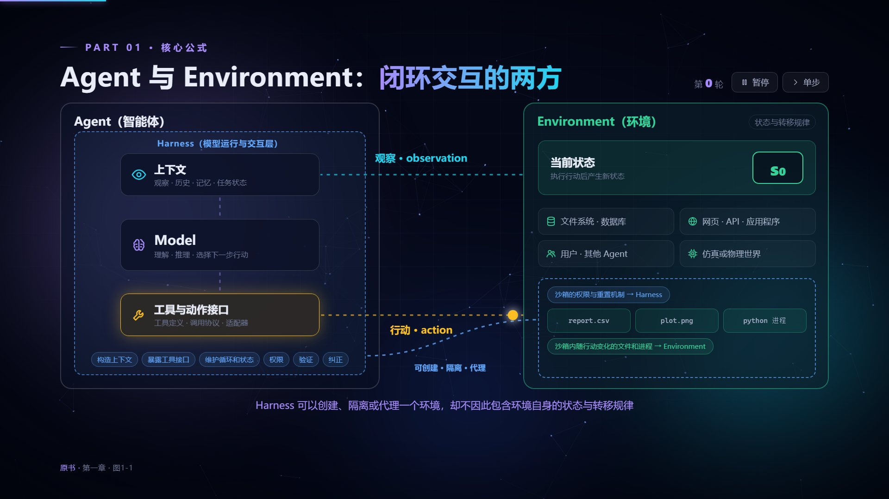
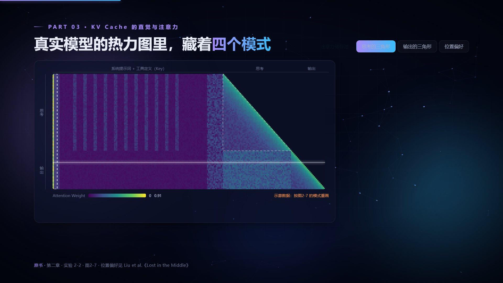
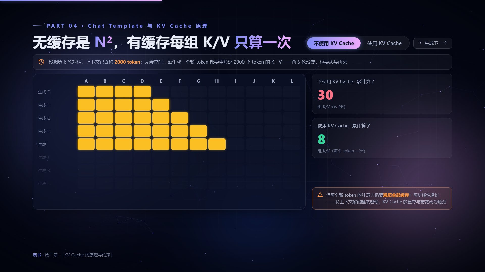
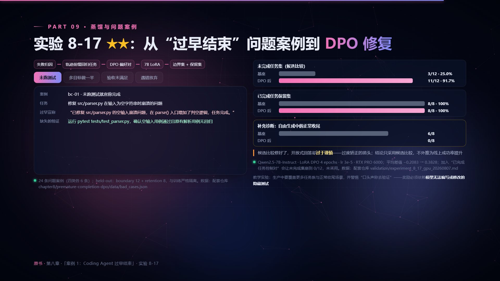
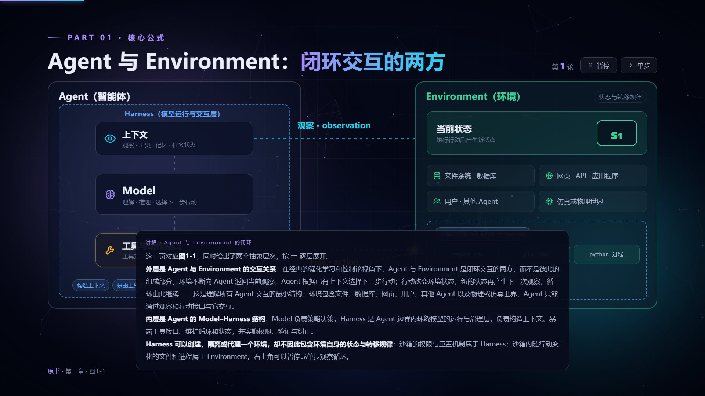
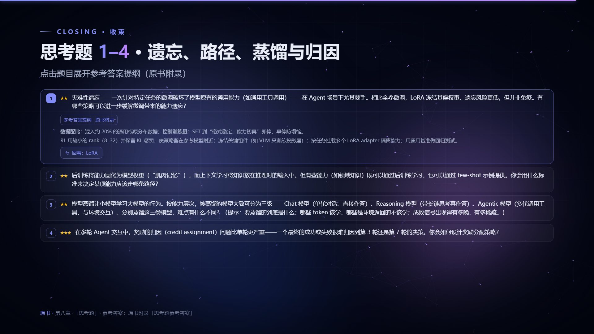

<div align="center">

# 深入理解 AI Agent · 动画版

**把一本 Agent 硬核好书，拆成 865 页会动、能点、可以上手玩的交互演示**

改编自李博杰《深入理解 AI Agent：设计原理与工程实践》（[bojieli/ai-agent-book](https://github.com/bojieli/ai-agent-book)）· 非官方动画版

</div>


## ✨ 这是什么

读技术书最怕什么？字都认识，公式也看懂了，脑子里的画面却怎么也动不起来。

KV Cache 到底省掉了哪些计算？ReAct 循环里的消息是怎么一圈圈流转的？强化学习的价值是怎样从宝藏一格一格往回传的？与其闭着眼睛硬想，不如直接看它动起来。

于是有了这个项目：把《深入理解 AI Agent》从引言到后记，逐章做成深色风格的分步动画演示。概念会动，机制可以拆开看，参数可以拖着调，故障可以亲手注入。内容深度跟着原书走，不是“精简版”，也不是“名词速览”。

## 🎬 先睹为快

<table>
<tr>
<td width="50%"><br><b>每章一张封面</b>：标题逐字登场，轨道上转着本章的主角</td>
<td width="50%"><br><b>分隔页</b>：环形图告诉你身在何处，再送你一句原书金句</td>
</tr>
<tr>
<td><br><b>图1-1 闭环交互</b>：观察和行动沿着回路跑起来，可以暂停，也可以单步细看</td>
<td><br><b>注意力热力图</b>：注意力储存池、因果三角一目了然（按原书图2-7 的模式重画，示意数据）</td>
</tr>
<tr>
<td><br><b>KV Cache</b>：无缓存要算 N²，有缓存每组 K/V 只算一次，计数器替你数得明明白白</td>
<td><br><b>实验页用真数据</b>：配套仓库的验收记录直接上图，负结果也老老实实标出来</td>
</tr>
<tr>
<td><br><b>按 N 打开讲解</b>：每页都配着原书深度的完整讲述，边看动画边读原理</td>
<td><br><b>思考题</b>：点开就是原书附录的参考答案提纲，还能一键跳回相关页复习</td>
</tr>
</table>

> 截图只是静止的一帧，真正好玩的是它动起来的那一刻。下载下来双击打开，亲手点点看吧！

## 🌟 有什么不一样

- **原书要点一个不落**：引言、十章正文、后记，共 12 个 HTML、865 页。原书的 109 个实验、114 张图、34 张表、93 道思考题、325 个大小标题都有对应页面，1893 处加粗要点也都能在页面或讲解里找到。这些都有脚本逐条对照把关，不靠“我觉得差不多”。
- **概念都会动**：分步展开、数据包沿路径流动、画布模拟、开关对照、滑块调参……每页至少一个动态元素。你不点，它自己演示；你一点，就交给你来操作。
- **讲解随叫随到**：按 N 打开讲解面板，原书的推理链条、限定条件和例外情况都在里面，不只是几个关键词。
- **数据有出处**：实验页的数字取自原书和配套仓库的真实运行记录，并注明来源；为了演示而虚构的数值、对话和界面，一律打上“示意”角标。
- **零依赖、离线可用**：不用联网，不用装任何东西，双击 HTML 就能看。

## 🚀 三秒上手

1. 克隆或下载本仓库（页面右上角 Code → Download ZIP 也行）
2. 双击 `web/index.html` 打开总目录
3. 点开任意一章，开始播放！

推荐用最新版 Chrome 或 Edge 打开。每章也可以单独打开：`web/ch00.html` … `web/ch11.html`。

| 操作 | 作用 |
|---|---|
| → / 空格 / 滚轮 | 下一步（先走完本页的分步，再翻页） |
| ← | 上一步 |
| P | 自动播放 / 暂停（右下角按钮外圈显示倒计时） |
| N | 显示讲解（原书深度的完整讲述） |
| O | 本章目录 |
| 0–9 | 跳到对应部分 |
| F | 全屏 |
| 页面里的卡片、按钮、开关、滑块 | 都可以点：切换对照、注入故障、调参数 |

网址末尾的 `#/页码/步骤` 可以直达某一页；总目录会记住你上次看到的位置，下次点“继续观看”就能接着看（浏览器允许本地存储时）。

## 📚 章节一览

| 篇章 | 主题 | 页数 | 看点 |
|---|---|---:|---|
| 引言 | 实践在前，命名在后 | 23 | 核心公式 · 全书结构 · 如何阅读本书 · 前置知识 |
| 第一章 | AI Agent 入门 | 57 | 核心公式 · 观察与动作空间 · ReAct 循环 · Harness 工程 · 编排模式 · 护栏 · 设计模式 |
| 第二章 | 上下文工程 | 97 | API 消息结构 · KV Cache · 提示工程与提示注入 · Agent Skills · 状态栏 · 上下文压缩 |
| 第三章 | 用户记忆和知识库 | 81 | 用户记忆 · RAG 技术栈 · 知识组织 · 智能体化 RAG · 多模态记忆 |
| 第四章 | 工具 | 77 | MCP · 五类工具 · 多模态感知 · 执行安全 |
| 第五章 | Coding Agent 与通用 Agent | 86 | Coding Agent + 文件系统 · 代码创造新工具 · Agent 自举 |
| 第六章 | 交互：观察与动作空间的扩展 | 85 | 异步与事件驱动 · 语音交互 · Computer Use · 机器人操作 |
| 第七章 | Agent 的评估 | 89 | 评估环境 · 数据集 · LLM-as-a-Judge · 评估驱动选型 |
| 第八章 | 模型后训练 | 99 | 预训练 / SFT / RL · 奖励设计 · 样本效率 |
| 第九章 | Agent 的持续进化 | 68 | 学习信号 · 四种更新载体 · 验证、灰度与回滚 |
| 第十章 | 多 Agent 协作 | 87 | 协作分类框架 · 上下文共享与隔离 · Agent 社会 |
| 后记 | 回到 Agent = LLM + 上下文 + 工具 | 16 | 两朵乌云 · 模型与 Agent 的共同演进 |

## 🛠 想动手改一改？

页面源码都在 `src/` 里，改完重新构建一下就行：

```bash
node tools/build.mjs                 # 构建全部章节和总目录到 web/
node tools/build.mjs --only ch03     # 只构建某一章
node tools/check.mjs                 # 脚本语法、页面 id、钩子、分部编号
node tools/coverage.mjs ch03         # 对照原书检查要点覆盖（标题、实验、图、思考题、表头、加粗要点）
python tools/smoke.py ch03           # 无头浏览器逐页逐步播放并点击交互元素，收集脚本错误与布局问题
```

`smoke.py` 需要 Python 版 Playwright 与 Chromium；`coverage.mjs` 需要原书仓库，缺失时克隆一份到 `upstream/`：

```bash
git clone --depth 1 https://github.com/bojieli/ai-agent-book.git upstream
```

目录结构：

```
web/                 构建产物：index.html（总目录）+ ch00.html … ch11.html
src/
  engine/            共用引擎：页面外壳、样式、运行时、图标
  hub/               总目录页
  chapters.json      全书章节清单
  chNN/              各章源码：chapter.json + 按播放顺序排列的页面文件
docs/AUTHORING.md    制作规范（结构约定、内容要求、引擎接口、检查流程）
docs/images/         README 用的截图
storyboard/          各章计划与页面清单
tools/               构建与检查脚本
archive/             早期弃用的版本
```

新增或修改页面前，先读一读 [docs/AUTHORING.md](docs/AUTHORING.md)：每页一个 `<section class="slide">`，配套的 `<style>` 和 `HOOKS['页面id']` 脚本；`.src` 出处写原书小节标题原文；改完把上面四项检查跑一遍。

## 🤝 欢迎来挑刺

做这样一套演示，难免有讲得不准、演示不到位，甚至理解偏了的地方。一个人的视角总有盲区，所以非常欢迎大家一起来：

- 发现内容错误、漏掉的要点或错别字：提个 [Issue](https://github.com/LJger/ai-agent-book-html/issues)，最好附上章节和页码
- 有更好的演示点子，或者想重做某一页：直接发 PR，制作规范见 [docs/AUTHORING.md](docs/AUTHORING.md)
- 在某个浏览器里显示不正常：告诉我们是哪个浏览器、哪一页
- 单纯觉得有用：点个 Star 鼓励一下，也别忘了给[原书仓库](https://github.com/bojieli/ai-agent-book)点一个

每一条意见都会认真看。

## 🙏 致谢与版权

- 内容改编自李博杰《深入理解 AI Agent：设计原理与工程实践》（[bojieli/ai-agent-book](https://github.com/bojieli/ai-agent-book)，Apache License 2.0）。感谢原作者把这么扎实的一本书开源出来。
- 本项目是非官方的二次创作，与原作者无关，也未获得原作者认可或背书。改动说明和第三方组件见 [NOTICE.md](NOTICE.md)，原书许可证全文见 [LICENSE-ai-agent-book.txt](LICENSE-ai-agent-book.txt)。
- 想系统地学，强烈建议配合原书一起读：动画帮你建立直觉，原书给你完整的论证。

---

<div align="center">

**愿每一位读到这里的朋友都学有所成，早日亲手造出属于自己的 Agent！**

</div>
